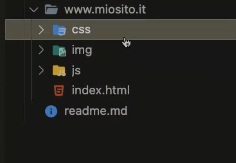
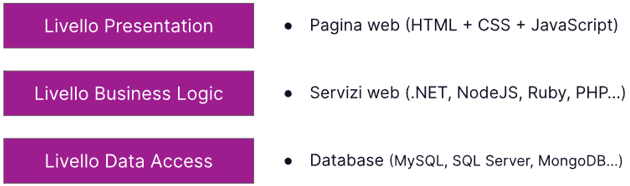
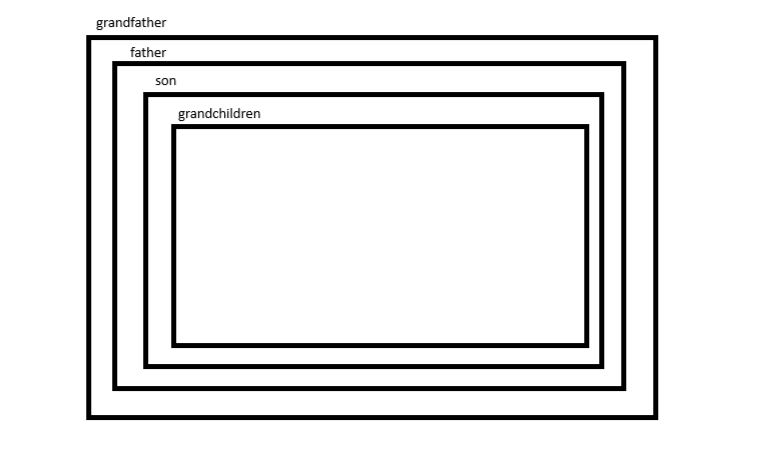
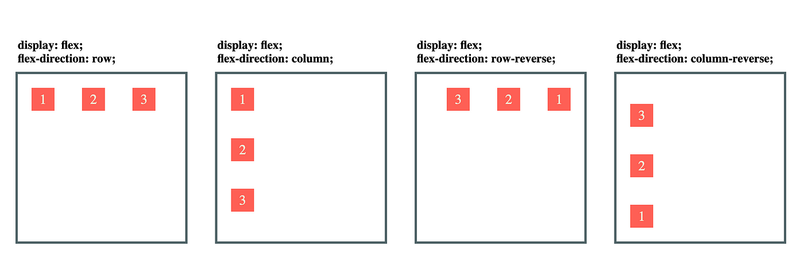
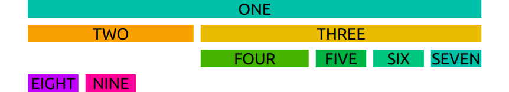

# HTML and CSS

## Front-end and back-end development

The front end runs in the browser and uses HTML, CSS, and JavaScript to display content and handle user interactions. The back end handles requests, applies application rules, and reads or writes data. A full-stack application can be described in three layers: presentation, application logic, and data storage.




## HTML

HTML stands for HyperText Markup Language. The browser parses HTML into the Document Object Model (DOM), which JavaScript can interact with and CSS can style.

| Element | Purpose |
| --- | --- |
| `<h1>` through `<h6>` | Headings ordered by level |
| `<p>` | Paragraph |
| `` | Image with alternative text where appropriate |
| `<figure>` | Self-contained content that can have a caption |
| `<button>` | Control that performs an action |
| `<span>` | Generic inline container |

```html
<body>
    <header>
        <nav aria-label="Main navigation">
            <a href="#content">Content</a>
        </nav>
    </header>
    <main id="content">
        <h1>Page title</h1>
        <p>Main content goes here.</p>
    </main>
    <footer>Site footer</footer>
</body>
```

## CSS

CSS stands for Cascading Style Sheets. A CSS rule uses a selector to choose elements and declarations to set their appearance.

```css
body {
    margin: 0;
    padding: 0;
}

.example {
    padding: 10px;
    font-size: 1rem;
}

#featured {
    background-color: lightblue;
}

main > div > p {
    color: darkred;
}
```

The last selector matches paragraphs that are direct children of a `div` that is itself a direct child of `main`.



### Flexbox

Set `display: flex` on a container to arrange its direct children as flex items. `flex-wrap: wrap` lets the items move onto another line when space runs out.

```css
.cards {
    display: flex;
    flex-wrap: wrap;
    justify-content: center;
    align-items: center;
    gap: 1rem;
}

.card {
    flex: 0 1 200px;
}
```

`justify-content` controls alignment along the main axis and `align-items` controls alignment along the cross axis. `flex-direction` determines which way the main axis runs. Give the container extra height if you want vertical centering to be visible in a row layout.



See the [MDN Flexbox guide](https://developer.mozilla.org/en-US/docs/Web/CSS/CSS_flexible_box_layout/Basic_concepts_of_flexbox) and [CSS positioning reference](https://developer.mozilla.org/en-US/docs/Web/CSS/position) for `static`, `relative`, `absolute`, `fixed`, and `sticky` positioning.

### Shadows and gradient text

`box-shadow` follows an element's box. `drop-shadow()` follows the visible pixels of an image, including the outline of a transparent PNG.

```css
.img1 {
    box-shadow: 10px 7px 20px orange;
}

.img2 {
    filter: drop-shadow(10px 7px 20px orange);
}

@supports (background-clip: text) {
    h1 {
        background-image: linear-gradient(90deg, #0e4b85, #2476b9);
        background-clip: text;
        color: transparent;
    }
}
```


### Hover and animations

Use a transition to make a change on hover gradual. Use `@keyframes` when an animation needs intermediate stages.

```css
.card {
    background-color: aquamarine;
    transition: transform 200ms ease, background-color 200ms ease;
}

.card:hover {
    background-color: tomato;
    transform: scale(1.05);
}

@keyframes change-color {
    0% { background-color: aquamarine; }
    50% { background-color: skyblue; }
    100% { background-color: tomato; }
}

@media (prefers-reduced-motion: no-preference) {
    .card.animate:hover {
        animation: change-color 1s linear forwards;
    }
}

@media (prefers-reduced-motion: reduce) {
    .card {
        transition: none;
    }
}
```

The [HTML demo](HTML%26CSS.html) shows shadows, gradient text, and a group of cards with hover effects.

## Bootstrap and Tailwind CSS

Bootstrap provides ready-made component classes and layout utilities. Tailwind CSS provides utility classes that you combine directly in your markup.

### Bootstrap

Install Bootstrap in an npm project or copy the versioned CDN tags and integrity hashes from the [Bootstrap documentation](https://getbootstrap.com/docs/5.3/getting-started/introduction/).

```sh
npm install bootstrap
```

In a bundled JavaScript project, import `bootstrap/dist/css/bootstrap.min.css`. Import the JavaScript bundle if you use interactive Bootstrap components that require it.

Bootstrap's default grid has 12 units per row. A `col-md-6` takes six units starting at the `md` breakpoint. Nest another row inside a column when you need a nested grid.

```html
<div class="container">
    <div class="row">
        <div class="col-md-6 text-primary">First column</div>
        <div class="col-md-6 text-success">Second column</div>
    </div>
</div>
```

See the [Bootstrap grid documentation](https://getbootstrap.com/docs/5.3/layout/grid/).

### Tailwind CSS

In a Vite project, install Tailwind CSS and its Vite plugin.

```sh
npm install tailwindcss @tailwindcss/vite
```

Add `tailwindcss()` to the existing `plugins` array in your Vite config after importing it from `@tailwindcss/vite`. Add the following line to the CSS file imported by your app.

```css
@import "tailwindcss";
```

Use utilities such as `text-sky-400/75` for color opacity and `text-[#50d71e]` for a custom color. The grid utilities use CSS Grid and support custom track definitions.

```html
<div class="grid grid-cols-1 gap-4 sm:grid-cols-3">
    <div class="text-sky-400/75">Cell 1</div>
    <div class="text-[#50d71e]">Cell 2</div>
    <div>Cell 3</div>
</div>
```



See the [Tailwind CSS Vite installation guide](https://tailwindcss.com/docs/installation/using-vite).
